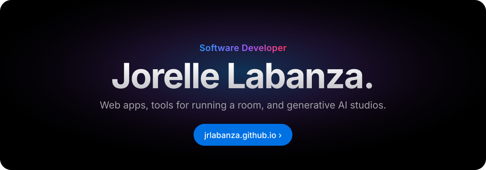

  <a href="https://jrlabanza.github.io/"><strong>jrlabanza.github.io</strong></a> · the portfolio: every project, the stack behind it, and the story so far.

## Featured

| Project | What it is |
|---|---|
| **[Jrlabanza Image Generator](https://github.com/jrlabanza/jrlabanza-image-generator-core)** | A one-person AI art studio built on Stable Diffusion WebUI Forge Neo. Python · React 19 · SDXL |
| **[BRACKET.GG](https://github.com/jrlabanza/bracket.gg)** | A tournament platform in one HTML file: seeding, double elimination, live set reporting, standings. |
| **[Online Trivia](https://github.com/jrlabanza/office-trivia-web-game)** | Kahoot-style multiplayer trivia for your LAN, with a built-in quiz editor. |
| **[Prompt Enhancer](https://github.com/jrlabanza/sd-prompt-enhancer)** | Guided prompt builder and reference-image tagger for Forge. |
| **[LoRA Trainer](https://github.com/jrlabanza/sd-lora-trainer)** | From a handful of images to a trained SDXL LoRA, in one tab. |

## Three lanes

**Generative AI** · Forge Neo extensions and studios &nbsp;&nbsp;·&nbsp;&nbsp; **Web apps** · React, Next.js, Node, MySQL &nbsp;&nbsp;·&nbsp;&nbsp; **Games and events** · brackets, trivia, party tools

Day to day I build internal tools and platforms at Parallaxx: risk engines, GIS, data platforms and AI agent tooling. [See the work ›](https://jrlabanza.github.io/#work)
